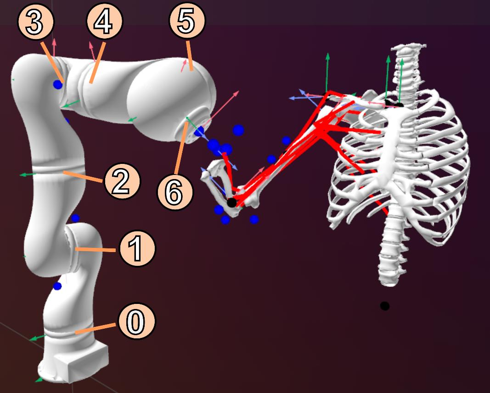
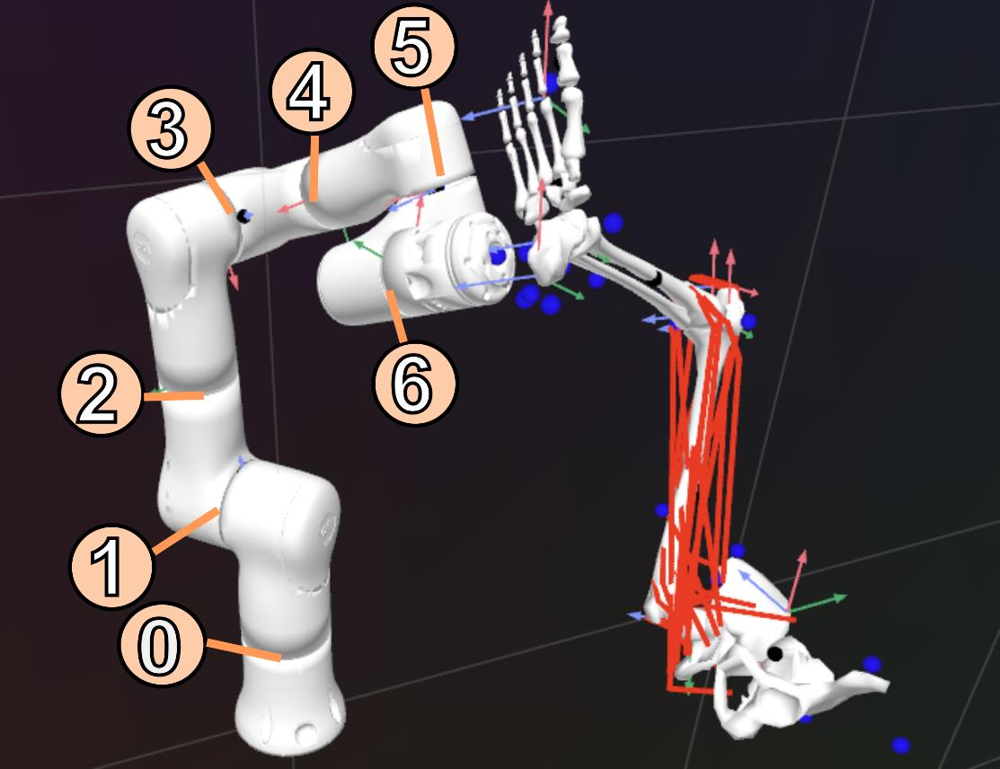
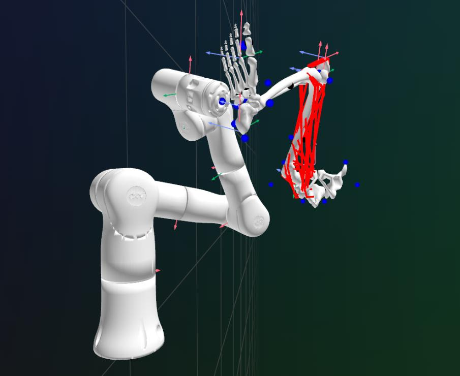
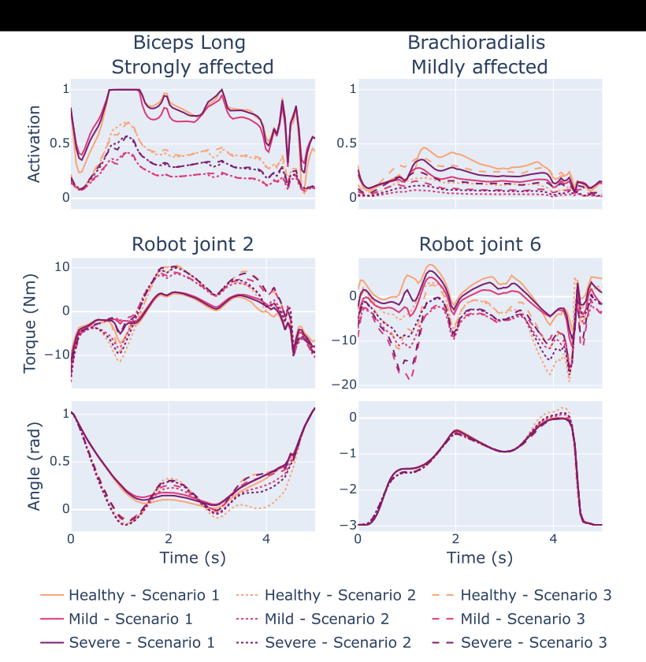

Comment assister les gestes du quotidien, ou rééduquer un muscle précis, avec un robot ? Ce projet couple un modèle musculo-squelettique du membre supérieur et un robot 7 axes dans une même chaîne cinématique fermée (contraintes holonomes) et utilise la commande optimale numérique pour calculer la commande du robot qui module l'activité musculaire visée.

- Simulation avec **bioptim**, accent sur les forces à l'interface humain-robot et sur l'effet de différents modes de contrôle (compensation de gravité, résistance visqueuse) sur l'activité musculaire du bras.
- Application à la rééducation du **supra-épineux** (International Shoulder Group 2026) et à des participants sains, légèrement ou sévèrement atteints (hémiplégie).
- Travaux commencés lors d'un séjour de trois semaines dans l'équipe du Prof. Mickaël Begon (Université de Montréal, septembre 2025). Une version journal est soumise à IEEE RA-L.

Publications : [Coupled Human-Robot Optimal Control with Holonomic Constraints…](/publications/schegg-2026-hr-optimal-control/) (soumis), [A unified human-robot simulation enables modulation of Supraspinatus muscle activation](/publications/schegg-2026-isg/) (ISG 2026).
