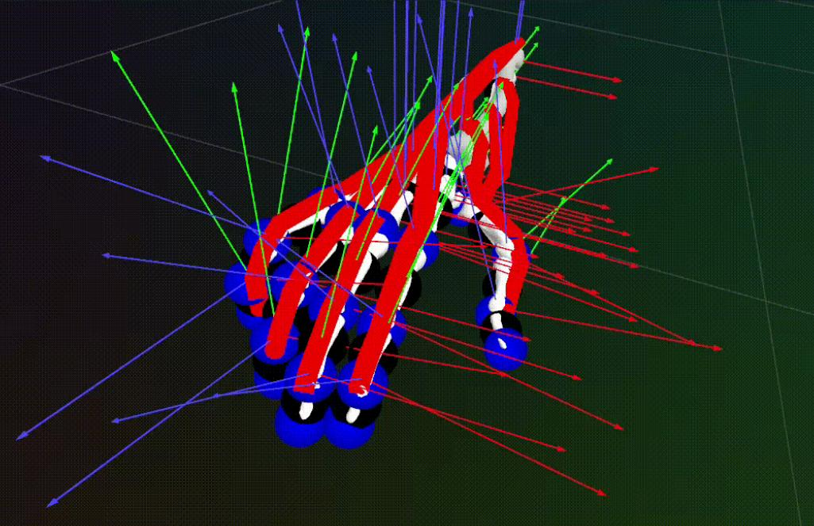
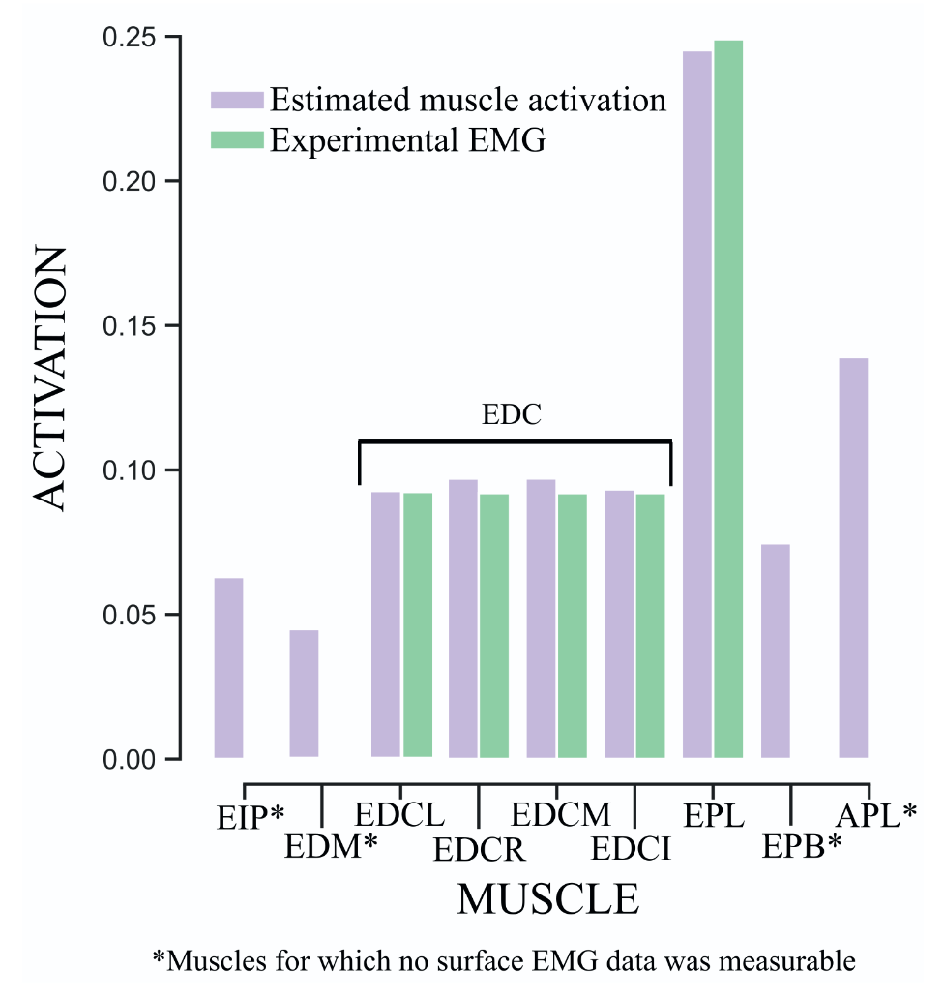
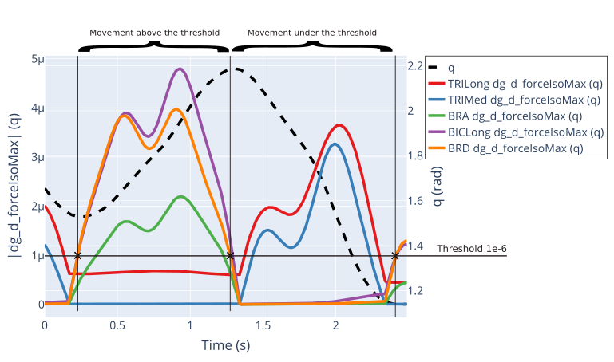

La personnalisation de modèles musculo-squelettiques du membre supérieur demande d'estimer des paramètres qui ne sont pas directement mesurables. Je m'intéresse à leur calibration par commande optimale numérique, à leur **observabilité**, et à la conception de mouvements (y compris en interaction avec un robot) qui les rendent observables.

- **Efficacité en données** : une petite quantité de données de haute qualité suffit à calibrer un modèle aussi bien que de grands jeux de données (CMBBE 2025).
- **Analyse de gradient** : l'estimation est plus précise pour les mouvements où le gradient de la contrainte de continuité vis-à-vis des paramètres musculaires est élevé (thèse de K. Bonnet, SB 2026).
- **Tétraplégie** : estimation optimale des activations de l'avant-bras évoquées par stimulation électrique implantée (thèse de V. Maggioni, SB 2025).
- **Hémiplégie** : simulations musculo-squelettiques personnalisées sur le jeu de données U-Limb (projet de M1 de D. Reyes Rapalo).

