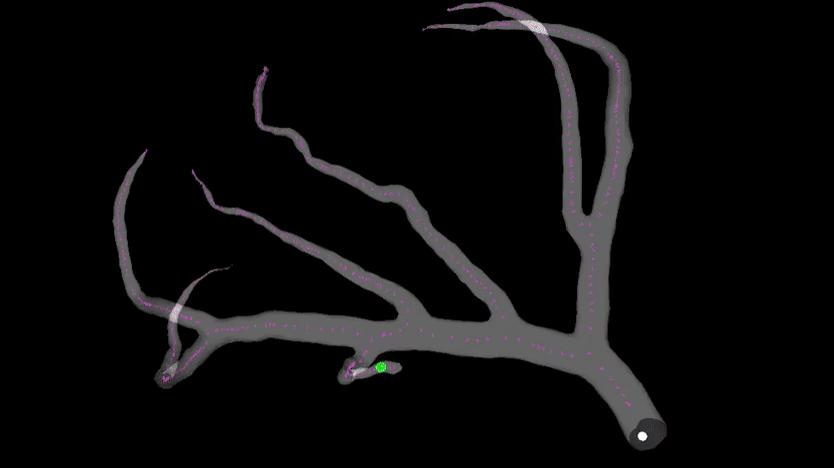
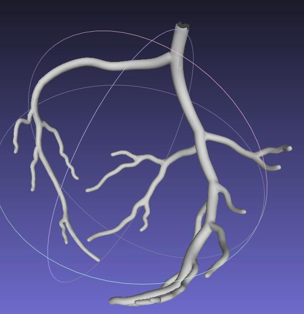
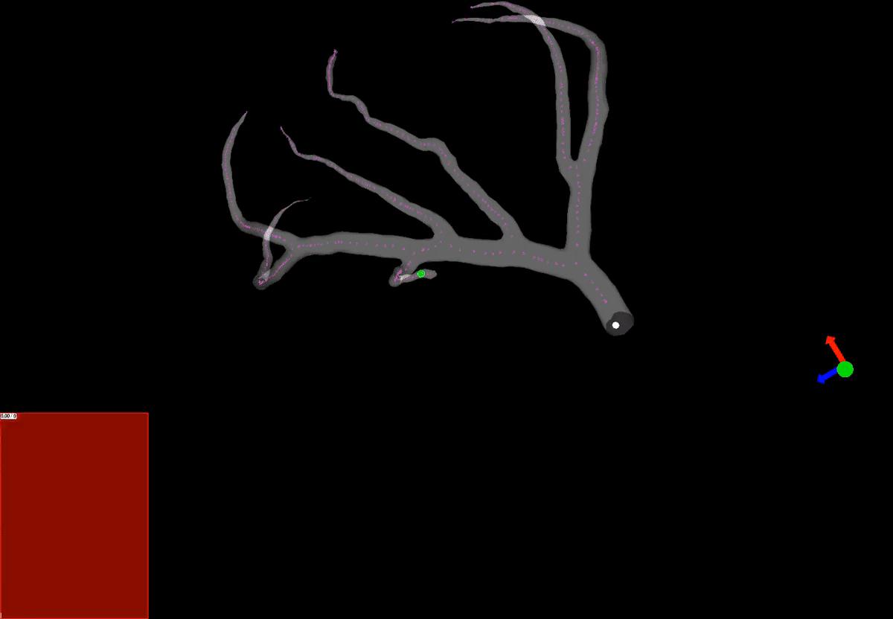
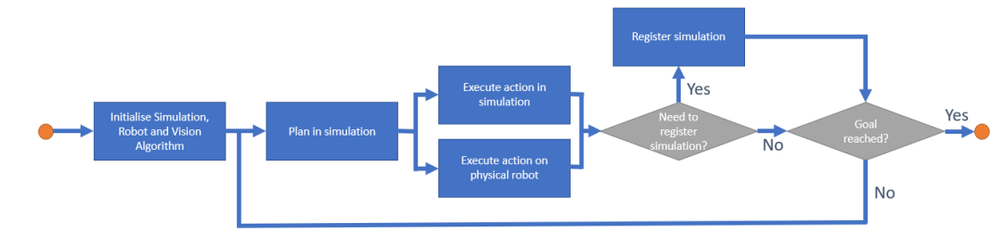

Navigation robotisée automatique de guides et de cathéters dans les artères coronaires, en trois parties :

1. **Simulation** : modélisation dynamique par éléments finis (SOFA) des artères et de leur interaction avec les instruments chirurgicaux.
2. **Commande** : programmation quadratique (modèle inverse), apprentissage par renforcement et recherche arborescente de Monte Carlo (MCTS) pour la planification.
3. **De la simulation à la réalité** : boucle de planification en simulation, exécution sur le robot physique, recalage de la simulation ; validation sur robot et fantôme, avec des algorithmes de vision par ordinateur pour détecter le guide.

Les apports théoriques et algorithmiques sont publiés dans [RoboSoft 2022](/publications/schegg-2022-robosoft/) et le brevet [WO2023280641](/publications/brevet-wo2023280641/). Les validations sur robot physique et fantôme ne sont publiées que dans le [manuscrit de thèse](/publications/schegg-2022-these/) (sous embargo). Encadrement : C. Duriez, J. Dequidt, P. Preux, B. Fournier.
