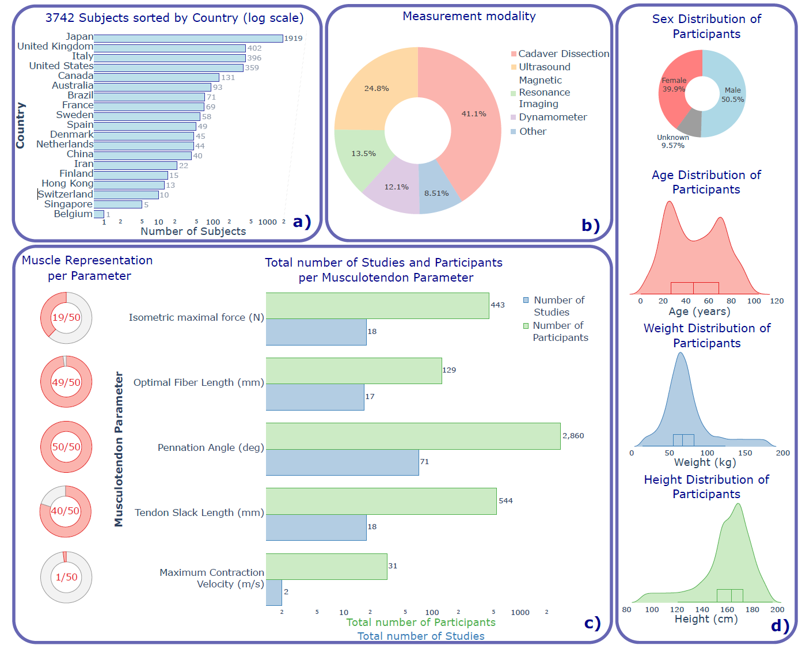
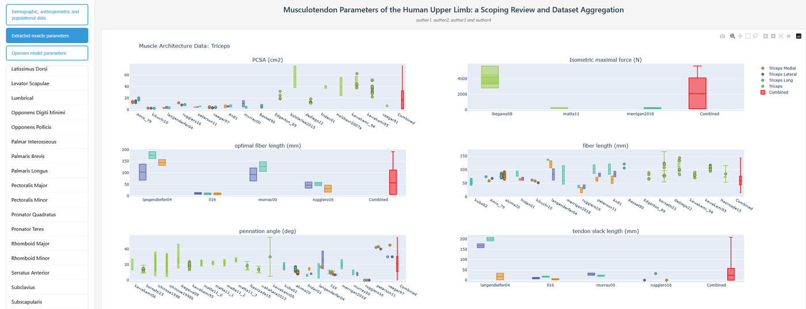

Une scoping review des paramètres musculo-tendineux (surface de section physiologique, force isométrique maximale, longueur des fibres optimale, angle de pennation, longueur de tendon, vitesse de contraction maximale) de tous les muscles du membre supérieur humain, constituant une large base de données des paramètres observés dans la littérature.

- Un **site web** et un **logiciel** permettent de naviguer dans la base et de la visualiser, par muscle et par groupe de muscles.
- Comparaison avec les paramètres des modèles génériques (par exemple pour l'épaule) et discussion de la validité de trois hypothèses courantes en modélisation biomécanique.
- Article en cours de revue dans *Sports Medicine* ; collaboration avec V. Maggioni, B. Faraud et F. Bailly (équipe CAMIN, Inria).

Publication : [Musculotendon Parameters of the Human Upper Limb](/publications/schegg-2025-musculotendon/).
