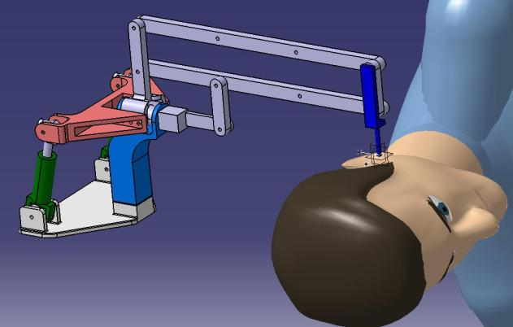
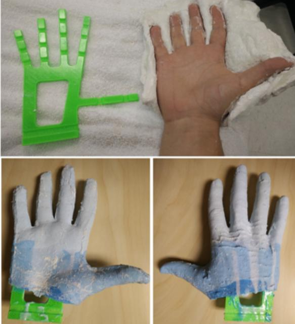
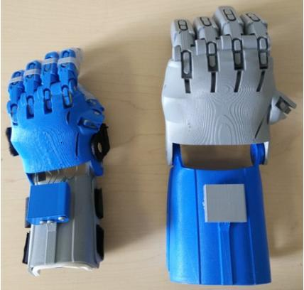

- **Analyse fonctionnelle et preuve de concept d'un robot porte-endoscope pour la chirurgie de l'oreille** (École Centrale de Nantes – CHU de Nantes). Ce projet de M2 a été intégré à une publication au Congrès Français de Mécanique 2019 ([Michel et al.](/publications/michel-2019-cfm/)), dans le cadre de la thèse de G. Michel.
- **Design de prothèse de main adaptative et recherche sur les prothèses compliantes** (Polytechnique Montréal – Centre de réadaptation Marie Enfant).

