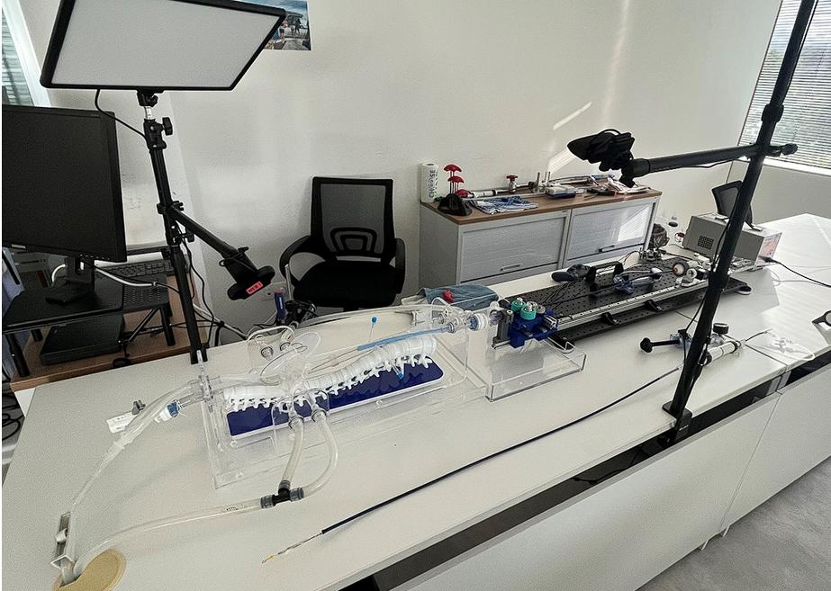
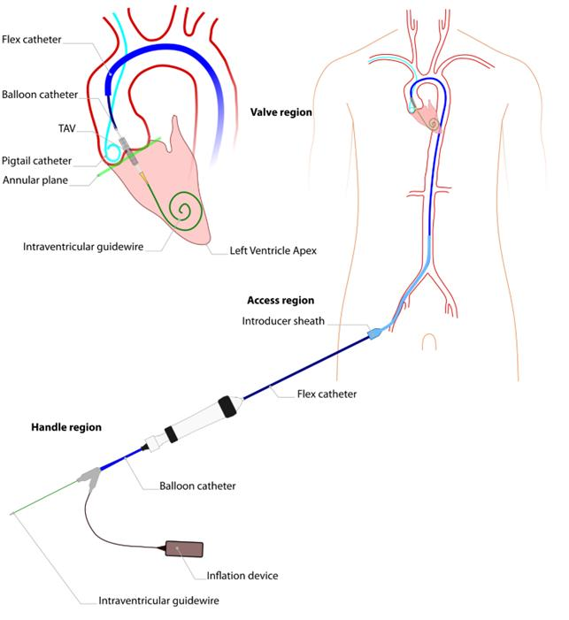
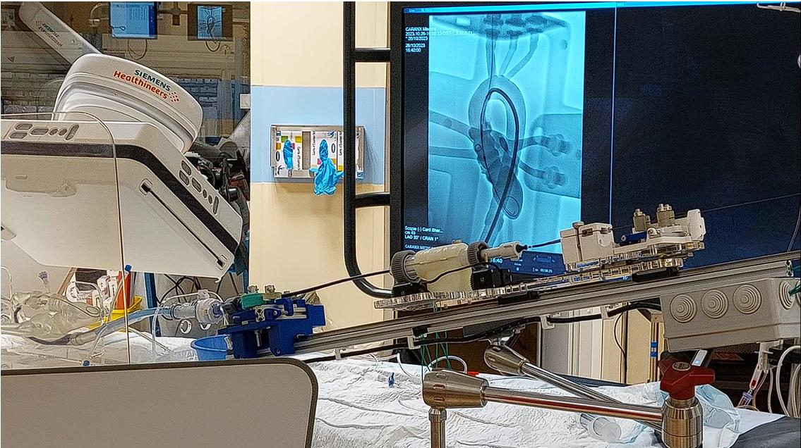
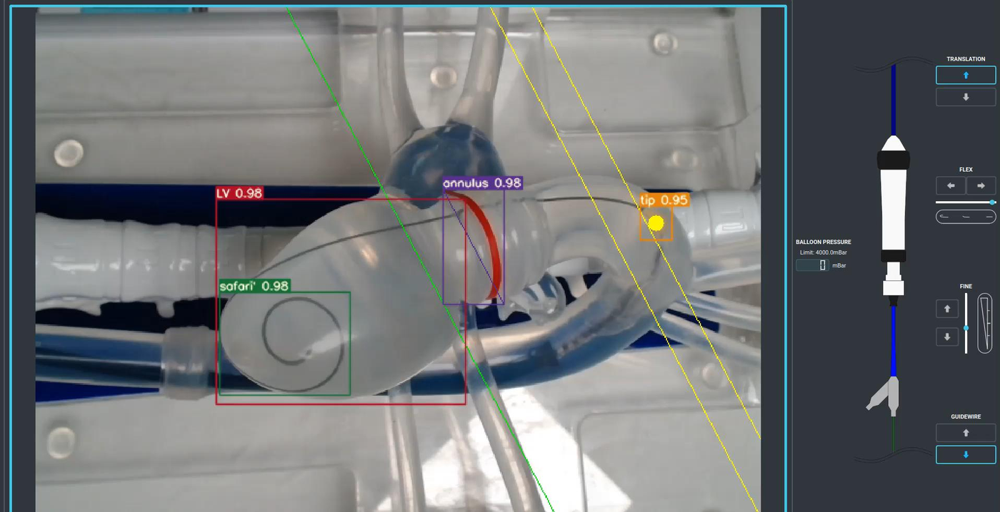

Développement chez Caranx Medical d'un robot de cardiologie pour l'implantation transcathéter de valve aortique (TAVI), de la conception aux tests sur animaux.

1. **Design mécatronique** : entraîneurs de cathéter, de poignée et de guide, interface avec la table, banc d'essai sur fantôme.
2. **Premier essai chez l'animal** en téléopération.
3. **Positionnement automatique sur fantôme** : détection de la valve et de l'anatomie sous fluoroscopie, boucle fermée.
4. **Tests utilisateurs** : comparaison de l'actuation manuelle, assistée, téléopérée et autonome (précision et répétabilité).

J'ai participé à la gestion du projet (équipe de 7 personnes) comme Scrum Master et encadré le stage de C. Languepin (conception et fabrication d'un robot pousse-seringue). Le projet a donné lieu à un article en accès ouvert et à plusieurs brevets ([WO2024200357](/publications/brevet-wo2024200357/), [WO2025012132](/publications/brevet-wo2025012132/), [WO2025141039](/publications/brevet-wo2025141039/)).

Publication : [Towards autonomous robot-assisted transcatheter heart valve implantation](/publications/smits-2025-tavi/) (Frontiers in Robotics and AI, 2025).
