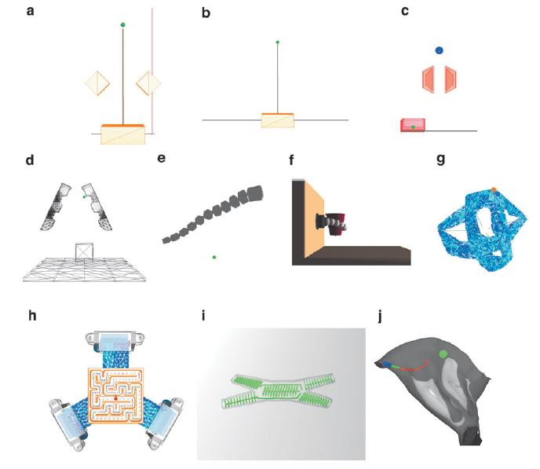
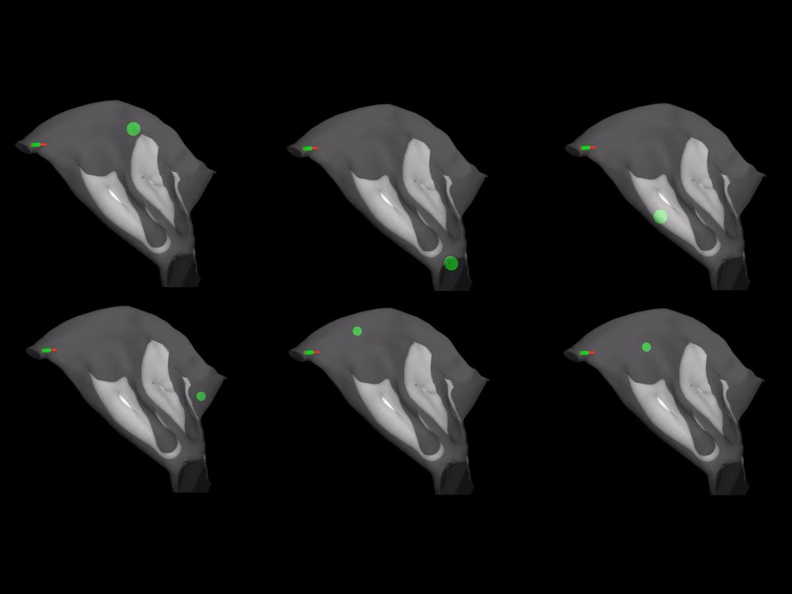
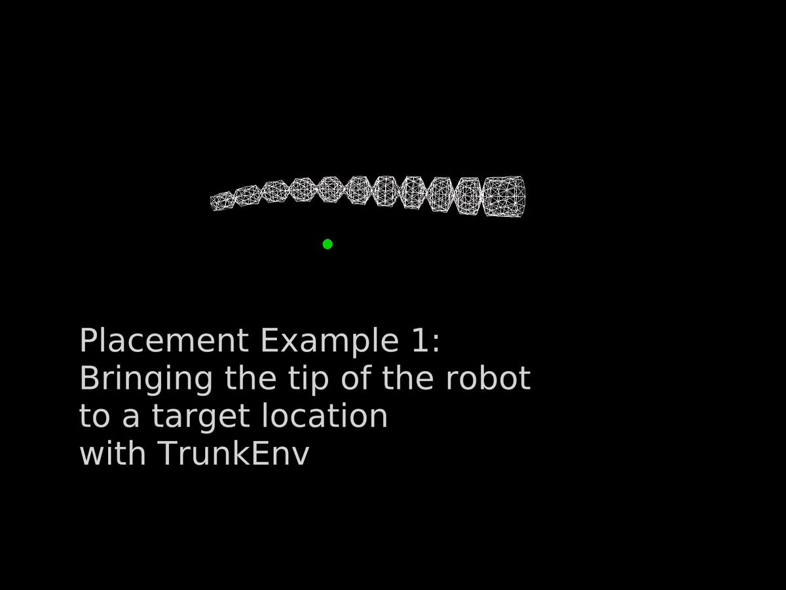

Projet parallèle à la thèse devenu une plateforme ouverte : des environnements de simulation de robots déformables (éléments finis, SOFA) exposés à l'interface standard de l'apprentissage par renforcement. Développée avec des stagiaires et des collègues (E. Ménager, E. Khairallah, D. Marchal, J. Dequidt, P. Preux, C. Duriez), elle a donné lieu à l'article [SofaGym](/publications/schegg-2023-sofagym/) dans *Soft Robotics*.

Encadrements associés : stages de M2 d'Etienne Ménager (graph RL, environnements SofaGym) et d'Elie Khairallah (gripper déformable à câbles, entraînement RL).
